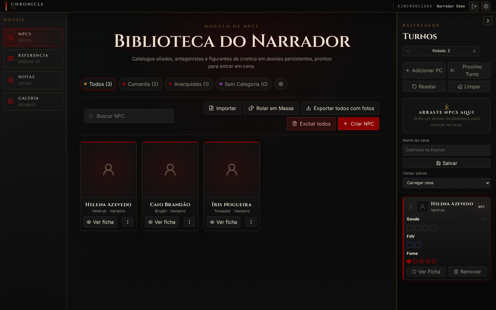
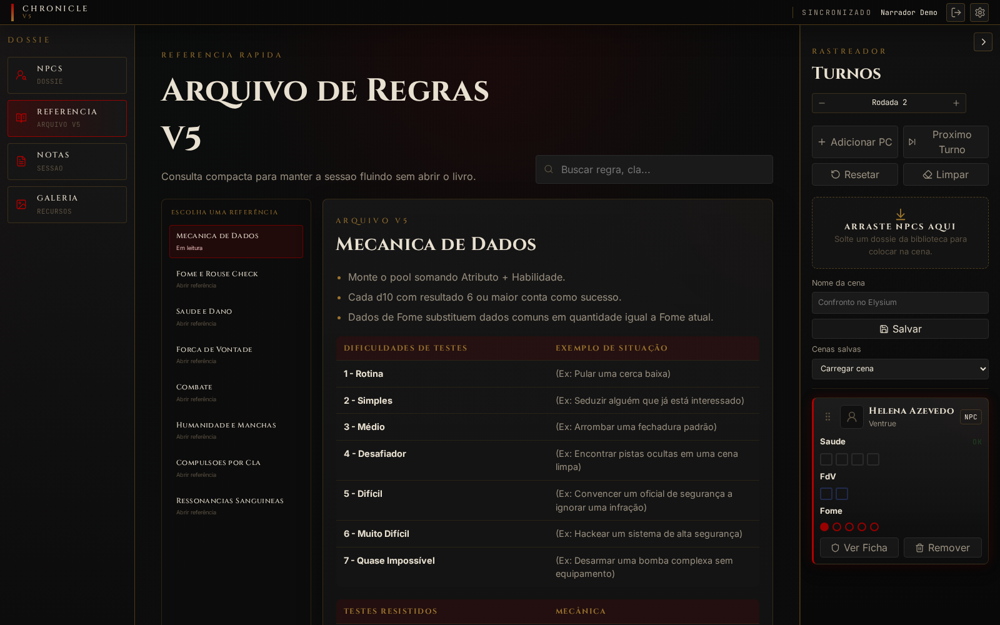
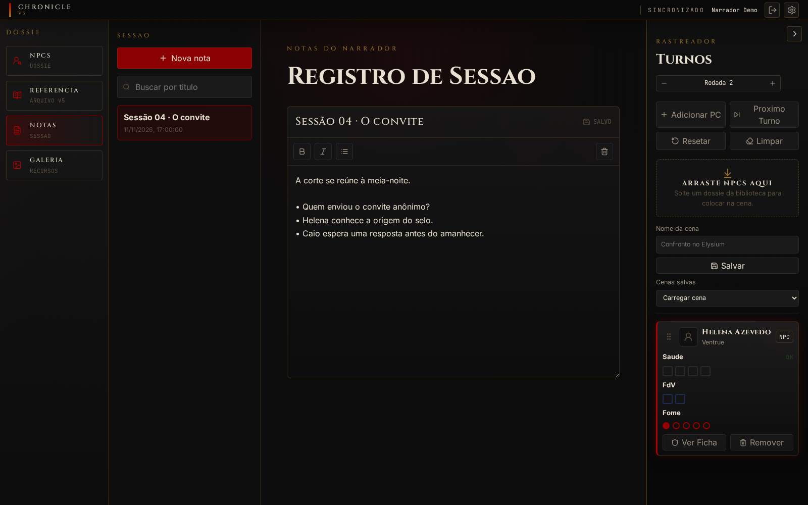
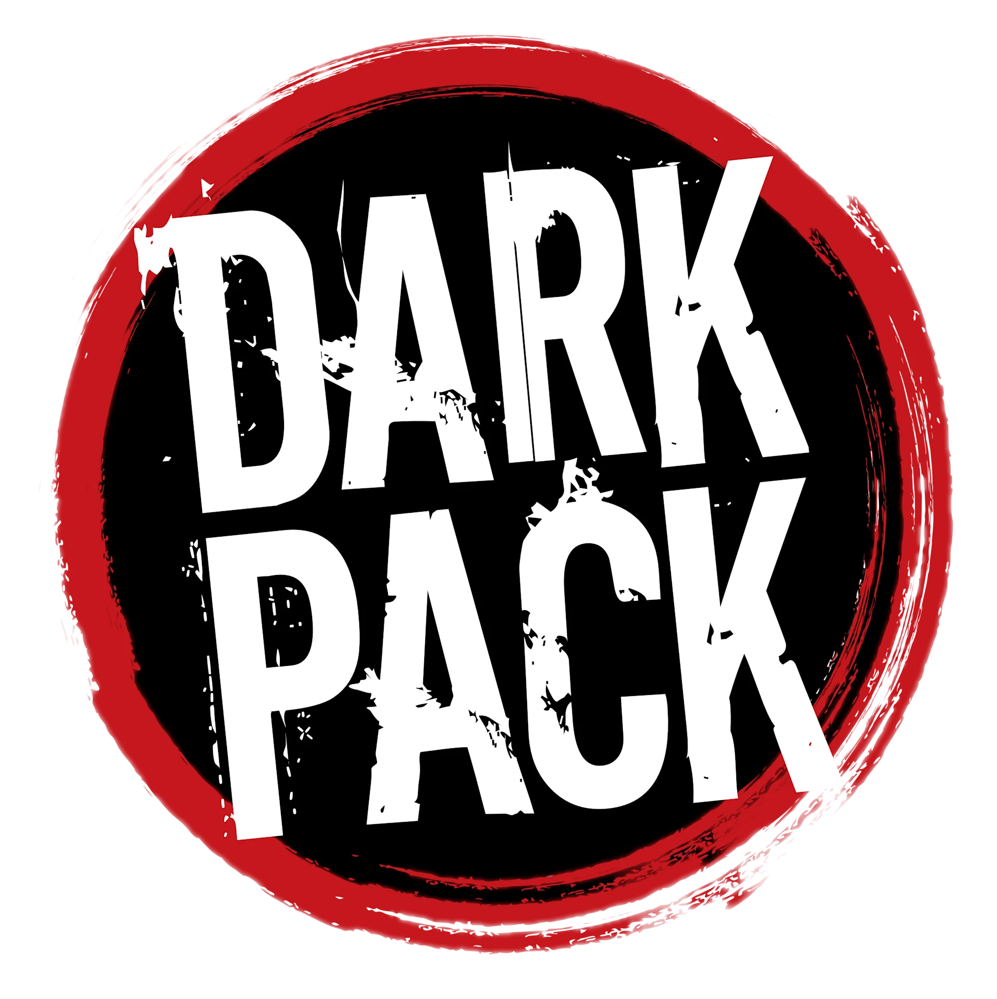

<div align="center">

# CHRONICLE DM

### O escudo digital para narrar Vampiro: A Máscara V5

NPCs, turnos, anotações e consulta rápida em uma única mesa de trabalho.

**Gratuito · Projeto de fã · Interface em português**

</div>



## Sua crônica à vista

O Chronicle DM foi criado para apoiar o Narrador durante a sessão. A biblioteca guarda os dossiês dos personagens; o rastreador lateral acompanha a ordem dos turnos, Saúde, Força de Vontade e Fome; as notas e a referência V5 ficam a um clique. O escudo funciona no navegador e pode ser usado com uma API local ou com uma conta Supabase configurada por você.

| Biblioteca de NPCs | Rastreador de turnos | Preparação da sessão |
| --- | --- | --- |
| Crie, categorize, busque, importe, exporte e consulte fichas de NPCs. | Adicione NPCs ou PCs, reorganize a ordem, avance rodadas e salve listas de participantes. | Registre notas com salvamento automático, consulte regras e organize imagens na galeria. |

### Mais telas

| Referência rápida | Notas da sessão |
| --- | --- |
|  |  |

As capturas mostram dados fictícios criados apenas para demonstrar a interface.

## Comece em seu computador

**Requisito:** Node.js 20 ou superior.

```bash
npm ci --include=dev
```

Em um terminal, inicie a API local:

```bash
npm run dev:api
```

Em outro, inicie a interface:

```bash
npm run dev
```

Abra o endereço mostrado pelo Vite, normalmente `http://127.0.0.1:5173/`, e crie uma conta local na tela inicial. A API usa SQLite e grava os dados em `data/vtm.sqlite`; esse diretório é ignorado pelo Git.

Para usar Supabase, consulte [`.env.example`](.env.example), configure as variáveis e execute as migrações necessárias para uma instalação nova. O escudo pode continuar usando a API local se nenhuma configuração do Supabase for fornecida.

## Comandos úteis

| Comando | O que verifica |
| --- | --- |
| `npm run lint` | Qualidade estática do código |
| `npm run typecheck` | Tipos TypeScript |
| `npm test` | Estado e rastreador |
| `npm run test:systems` | Domínio de regras V5 |
| `npm run test:e2e` | Fluxos da interface no navegador |
| `npm run build` | Build de produção |
| `node scripts/capture-readme.mjs` | Regenera as capturas com dados fictícios |

## Estrutura e implantação

- `src/`: interface React, rastreador, biblioteca e módulo V5.
- `server/`: API local e SQLite.
- `supabase/`: migrações e configuração opcional para contas e personagens.
- `netlify/` e `netlify.toml`: função de API e build do frontend para Netlify.
- `e2e/` e `test/`: testes de interface e lógica.

Para Netlify, o build é `npm run build` e o diretório publicado é `dist`. As migrações em `supabase/migrations` também registram o histórico de instalações anteriores; não remova migrações já aplicadas a um banco remoto.

## Licença e avisos

O código deste projeto é distribuído sob a [GNU AGPL v3](LICENSE), acompanhando o módulo de personagem V5 adaptado do Progeny. Textos de regras, marcas, símbolos, imagens e outros materiais de terceiros permanecem com seus respectivos titulares. Consulte [THIRD_PARTY_NOTICES.md](THIRD_PARTY_NOTICES.md) para créditos e escopos das licenças.

Chronicle DM é um projeto de fã gratuito e não oficial. Vampiro: A Máscara e Mundo das Trevas são marcas e propriedade intelectual da Paradox Interactive AB. Consulte o [Dark Pack Agreement](https://www.paradoxinteractive.com/games/world-of-darkness/community/dark-pack-agreement) para as condições de uso.

<div align="center">
  
</div>
